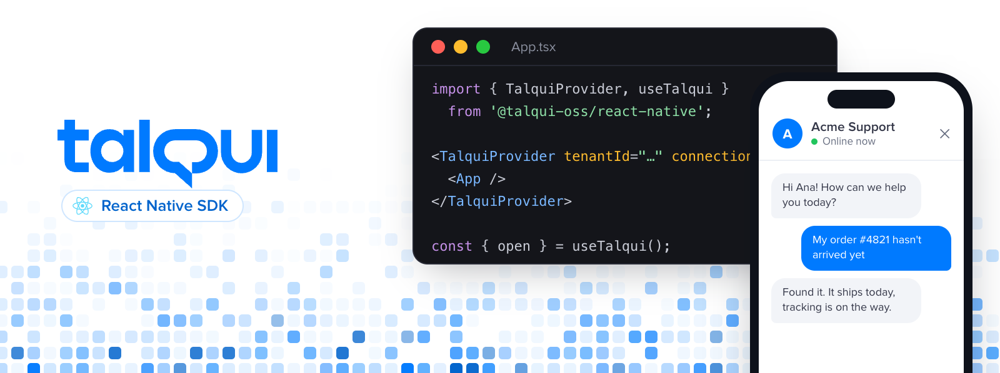
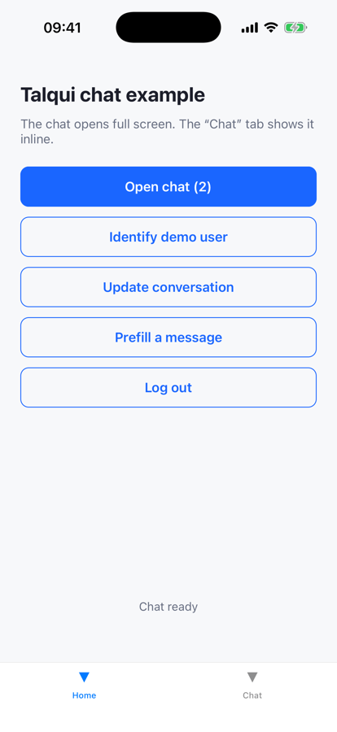
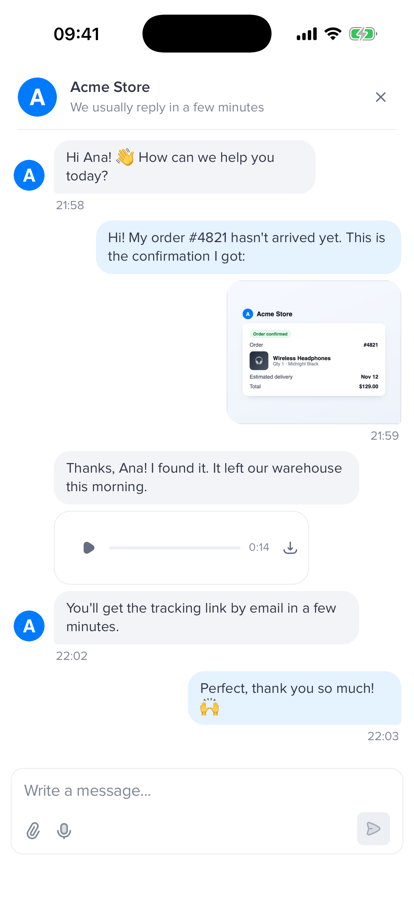
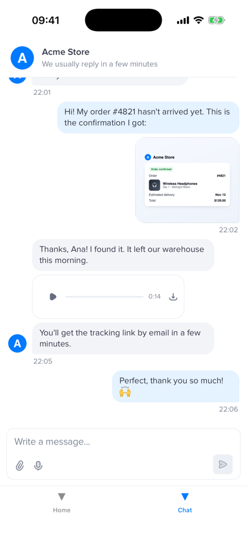

<div align="center"><strong>Talqui for React Native</strong></div>
<div align="center">Live chat for your React Native and Expo apps.<br />Your users talk to your team, bots and AI agents without leaving the app.</div>
<br />
<div align="center">

[](https://www.npmjs.com/package/@talqui-oss/talqui-sdk-reactnative)
[](https://expo.dev/go)
[](https://reactnative.dev)
[](https://github.com/talqui-oss/talqui-sdk-reactnative/blob/main/LICENSE.md)

</div>
<div align="center">
<a href="https://docs.talqui.chat/guides/chat-sdks/react-native">Documentation</a>
<span> · </span>
<a href="https://www.npmjs.com/package/@talqui-oss/talqui-sdk-reactnative">npm</a>
<span> · </span>
<a href="./example">Example app</a>
<span> · </span>
<a href="https://talqui.chat">Talqui</a>
</div>

## Introduction

[Talqui](https://talqui.chat) is the communication layer for customer service and sales. It connects every channel your customers use, including your website and your app, to one workspace where AI agents, chatbots and human teams work together: build chatbots without code, put AI agents on the front line for support and sales, hand conversations over to people when it matters, and plug everything into your own systems.

This package brings that experience into your React Native app. Drop in a provider, call `open()` from any button, and each conversation lands in the same workspace as every other channel, with history, attachments, voice messages, chatbots and AI agents.

## Features

- **Works in Expo Go.** No native code of its own, no config plugin, no dev build.
- **Full screen or inline.** `open()` from any button, or `<TalquiChat />` inside a tab.
- **Knows who is talking.** Pass the logged-in user and data about the conversation (an order, a plan, the screen they are on), at any moment.
- **Events and unread badge.** React to new messages, sent messages and the chat being closed.
- **Safe logout.** One call and the next person on the phone starts from nothing.
- **Small surface.** One provider, two hooks, one component. Fully typed.

## Screenshots

What your users see, from the [example app](https://github.com/talqui-oss/talqui-sdk-reactnative/tree/main/example) on iOS.

<table align="center">
  <tr>
    <td width="33%">
      
      <p align="center"><strong>Unread count</strong><br />Replies that arrive while the chat is closed</p>
    </td>
    <td width="33%">
      
      <p align="center"><strong>Full screen chat</strong><br />Text, images and voice messages</p>
    </td>
    <td width="33%">
      
      <p align="center"><strong>Inline in a tab</strong><br /><code>&lt;TalquiChat hideCloseButton /&gt;</code></p>
    </td>
  </tr>
</table>

## Requirements

| | Minimum |
| --- | --- |
| React Native | 0.73 (Expo SDK 50) |
| iOS | 15 |
| Android | 7.0 (API 24) |

## Install

```bash
npx expo install @talqui-oss/talqui-sdk-reactnative react-native-webview @react-native-async-storage/async-storage
```

Bare React Native: install the same three packages with your package manager, then run `cd ios && pod install`.

## Get your IDs

You need two values from your Talqui workspace, both on **app.talqui.chat → Plugins → WebChat → Installation**:

- **Tenant ID**: your workspace.
- **Connection ID**: the WebChat connection the app's conversations arrive through.

[Step by step with screenshots →](https://docs.talqui.chat/guides/chat-sdks/get-your-ids)

## Quick start

Wrap your app once:

```tsx
import { TalquiProvider } from '@talqui-oss/talqui-sdk-reactnative';

export default function App() {
  return (
    <TalquiProvider tenantId="YOUR_TENANT_ID" connectionId="YOUR_CONNECTION_ID">
      <Home />
    </TalquiProvider>
  );
}
```

Open the chat from anywhere below it:

```tsx
import { useTalqui } from '@talqui-oss/talqui-sdk-reactnative';
import { Button } from 'react-native';

function Home() {
  const talqui = useTalqui();
  return <Button title="Talk to us" onPress={talqui.open} />;
}
```

That's it. The chat opens full screen and closes with the header button or the Android back button.

### Inline, in a tab

```tsx
import { TalquiChat } from '@talqui-oss/talqui-sdk-reactnative';
import { useIsFocused } from '@react-navigation/native';

function ChatScreen() {
  return <TalquiChat style={{ flex: 1 }} visible={useIsFocused()} hideCloseButton />;
}
```

`visible` tells the SDK whether the tab is on screen, so unread messages are counted while it is not. `hideCloseButton` removes the close button from the chat header, which has nothing to close in a tab. Full screen always keeps it.

## Identify users

Once your user logs in, tell the chat who they are. The pre-chat form is skipped and your team sees the name, email and phone:

```ts
await talqui.identify({ name: 'Ana Souza', email: 'ana@example.com', phone: '+5511999990000' });
```

To keep a user's history across devices and reinstalls, also pass a `userHash`. Compute it **on your backend**, never in the app:

```
userHash = HMAC_SHA256(secret, "<tenantId>:<userId>")   // lowercase hex
```

Anyone holding a `userHash` can read that user's conversation, so treat it like a session token. [Read more →](https://docs.talqui.chat/guides/chat-sdks/identify-users)

## Metadata

Send context your team will see next to the conversation:

```ts
talqui.setContactMeta({ plan: 'pro', seats: 12 });           // about the person, kept on their contact
talqui.setSessionMeta({ order_id: '4821', step: 'checkout' }); // about this conversation, change it any time
talqui.setSessionMeta({ step: null });                        // null removes a key
```

Keys use lowercase letters, digits, `_` and `-` (up to 60 chars). Values are strings, numbers or booleans, stored as text up to 255 chars. Calls made before the chat loads are queued and sent once it is ready. [Read more →](https://docs.talqui.chat/guides/chat-sdks/metadata)

## Events

```tsx
import { useTalqui, useTalquiEvent } from '@talqui-oss/talqui-sdk-reactnative';

useTalquiEvent('messageReceived', (event) => {
  console.log(`${event.operatorName ?? 'Support'}: ${event.preview}`);
});

const { unreadCount } = useTalqui(); // for a badge
```

| Event | When | Payload |
| --- | --- | --- |
| `ready` | The chat finished loading | `{ protocol, webchatVersion, identity }` |
| `sessionStarted` | The user started a conversation | `{ sessionId }` |
| `messageSent` | The user sent a message | `{ messageId, type }` |
| `messageReceived` | Your team, a bot or an agent replied | `{ messageId, type, preview, operatorName }` |
| `unreadChanged` | The unread count changed | `{ count }` |
| `closeRequested` | The user tapped close in the header | `{}` |
| `openUrl` | The user tapped a link | `{ url }` |
| `error` | A command was rejected | `{ code, message }` |

[All events →](https://docs.talqui.chat/guides/chat-sdks/events)

## Logout

Call it when your user logs out. It forgets the user on this device, clears everything you set and starts a fresh anonymous visitor:

```ts
await talqui.logout();
```

## API

### `<TalquiProvider>`

| Prop | Type | |
| --- | --- | --- |
| `tenantId` | `string` | Required. Your workspace id. |
| `connectionId` | `string` | Required. The WebChat connection id. |
| `onOpenUrl` | `(url: string) => void` | Handles links tapped in the chat. Default: `Linking.openURL`. |
| `renderLoading` | `() => ReactNode` | Replaces the loading spinner. |
| `renderError` | `(retry: () => void) => ReactNode` | Replaces the screen shown when the chat cannot load. |
| `debug` | `boolean` | Logs every message exchanged with the chat. |

### `useTalqui()`

| Member | |
| --- | --- |
| `open()` / `close()` | Show or hide the full-screen chat. The conversation keeps running while hidden. |
| `preload()` | Loads the chat ahead of time so `open()` is instant and unread messages are counted. |
| `identify(user)` | Sets who the user is (`name`, `email`, `phone`, `userHash`). |
| `setContact(contact)` | Updates `name`, `email` or `phone`. |
| `setContactMeta(meta)` / `setSessionMeta(meta)` | Custom data, see [Metadata](#metadata). |
| `prefill(text)` | Puts text in the message box. The user still decides to send it. |
| `logout()` | Forgets the user and starts a fresh visitor. |
| `unreadCount`, `isReady`, `isOpen` | Current state. |

### `<TalquiChat>`

| Prop | Type | |
| --- | --- | --- |
| `style` | `ViewStyle` | Usually `{ flex: 1 }`. |
| `visible` | `boolean` | Whether this screen is on screen. |
| `onCloseRequested` | `() => void` | The user tapped close in the header. |
| `hideCloseButton` | `boolean` | Hides the header's close button here. Default `false`. |

## Permissions

Attachments, photos and voice messages need these entries. With Expo, in `app.json`:

```json
{
  "expo": {
    "ios": {
      "infoPlist": {
        "NSCameraUsageDescription": "Take photos to send in the support chat.",
        "NSMicrophoneUsageDescription": "Record voice messages for the support chat.",
        "NSPhotoLibraryUsageDescription": "Choose photos to send in the support chat."
      }
    },
    "android": {
      "softwareKeyboardLayoutMode": "resize",
      "permissions": ["android.permission.CAMERA", "android.permission.RECORD_AUDIO", "android.permission.MODIFY_AUDIO_SETTINGS"]
    }
  }
}
```

Bare React Native: the same keys in `ios/<App>/Info.plist` and `android/app/src/main/AndroidManifest.xml`, plus `android:windowSoftInputMode="adjustResize"` on your main activity.

## Example app

```bash
cd example
npm install
npx expo start
```

Open it in Expo Go. It has an "Open chat" button that shows the unread count, a "Chat" tab, and buttons for identify, metadata, prefill and logout, connected to the Talqui demo workspace.

## Troubleshooting

- **The attach or camera button does nothing**: the permissions above are missing.
- **The keyboard covers the message box on Android**: set `softwareKeyboardLayoutMode: "resize"` (Expo) or `adjustResize` (bare).
- **"Invalid link" screen**: `tenantId` or `connectionId` is wrong.
- **`useTalqui must be used inside <TalquiProvider>`**: the provider must wrap every screen that uses the hook.

[More →](https://docs.talqui.chat/guides/chat-sdks/troubleshooting)

## How it works

The SDK hosts the Talqui WebChat in a `react-native-webview` and talks to it through a small, versioned message protocol ([`docs/BRIDGE_PROTOCOL.md`](./docs/BRIDGE_PROTOCOL.md)). The visitor's identity lives in AsyncStorage, owned by the SDK, so logout is complete and the chat page itself keeps nothing between users. Chat features ship from Talqui's side without an app update.

## Contributing

Issues and pull requests are welcome. Run `pnpm install`, then `pnpm typecheck` and `pnpm test` before opening a PR.

## License

[MIT](./LICENSE.md) © [Talqui](https://talqui.chat)
